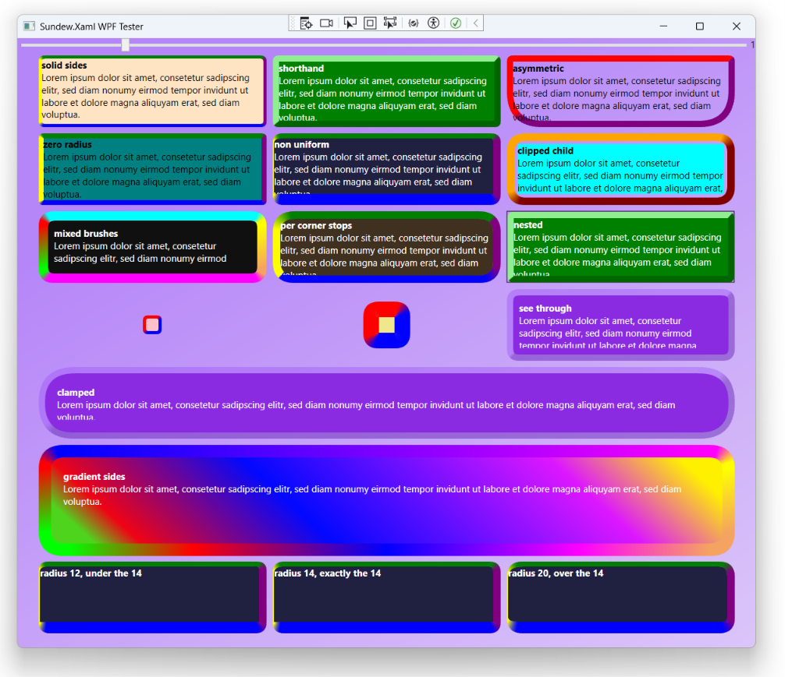

# Sundew.Xaml

## Controls:
* Border - A custom four-sided border, allowing more control over corner transitions.
  (WPF, Avalonia, WinUI, Uno, MAUI)

### Examples:

### Known issues/Todo:
* A corner radius between nothing and the thickness of the thicker of the two sides meeting it is drawn at that
  thickness. A radius of 0 is square and mitred, and a radius over the thickness is drawn as asked, but the range
  in between cannot be: the inner boundary would have to leave the inner rectangle and bulge into the thicker side.
* Performance optimizations
* The Avalonia tester’s `--render` writes a blank image. It renders the view detached from a top level, which
  leaves it unstyled and undrawn. The Avalonia captures in the table below were taken another way.

### How the drawing is shared:
The WinUI, Uno and MAUI libraries paint from one set of source files under `Source/Shared`. `BorderRenderer`
holds the whole of how a border is painted, `IBorderDrawingSession` is the handful of fills a backend has to
provide, and `Paint`, `PaintStop`, `PaintColor` and `CornerBlend` are what it paints with. None of them knows
about XAML or about any one graphics library, so the Skia session is shared too, and only `BrushResolver`, which
turns one framework’s brushes into a `Paint`, is written per framework.

Colours cross that seam as `PaintColor` rather than any framework’s own type, which is what lets the same files
serve `Windows.UI.Color` on WinUI and Uno and the float channels of `Microsoft.Maui.Graphics.Color` on MAUI.

### WinUI and Uno notes:
* One package, `Sundew.Xaml.Controls.WinUI`, serves both WinUI 3 and every Uno target, because Uno implements the
  same `Microsoft.UI.Xaml` API. It cross targets `net9.0-windows10.0.19041.0`, which is WinUI 3 proper and also the
  Windows head of an Uno app, and `net9.0`, which is every other Uno target.
* Neither WinUI nor Uno lets a control paint itself the way WPF and Avalonia do, so the border is a `Panel` holding a
  drawing surface behind a plain `Border` that carries the content. The surface is the only part that differs:
  Win2D on Windows, Skia (`SKCanvasElement`) everywhere else. Both run the same `Border` over `IBorderDrawingSession`,
  and `BorderRenderer` holds the whole of how a border is painted, free of XAML and of any one graphics library.
  A further backend is a matter of implementing `IBorderDrawingSession` and nothing else.
* WinUI only lets `Clip` be a rectangle, so the rounded part of `ClipContentToCornerRadius` is left to the corner
  radius of the plain border holding the content, which both WinUI and Uno clip to natively.
* Neither WinUI nor Uno honours a `TypeConverter`, on the type or on the property, so `Stops`, `CornerStops` and
  `SideBrushes` carry `CreateFromString` as well, which both do honour. The attribute only exists where WinUI or Uno
  is referenced, so `Stops` and `CornerStops` live in `Source/Shared` and each platform library compiles its own
  copy. Sharing them as an assembly instead would put the same type name in two assemblies of one reference graph,
  which neither XAML compiler can resolve.
* `Background` deliberately hides `Panel.Background`, which a panel would otherwise paint as a plain rectangle with
  square corners behind the rounded border.
* WinUI has no `LayoutTransform` and its brushes have no `RelativeTransform`, so the tester sheet zooms with a render
  transform and its one rotated background gradient runs straight across instead.

### MAUI notes:
* One backend serves every MAUI target. MAUI offers a Skia canvas on all of them, Windows included, so unlike
  the WinUI and Uno library there is nothing to switch on: `SKCanvasView` is the surface everywhere. Win2D would
  work on the Windows target, since that target is WinUI 3, but it would buy little, because Win2D and Skia
  already agree to 0.65% of pixels, and it would cost a handler for one target alone. The seam is kept all the
  same: a Win2D surface would be an `IBorderSurface` and a drawing session, and nothing else would change.
* The border paints its own `Fill` rather than the inherited `Background`. MAUI paints a `VisualElement`
  background itself, as a plain rectangle behind the whole control, which would show square corners outside the
  rounded border. `Padding` is likewise `ContentPadding`, because a MAUI `Layout` already has a `Padding` and it
  would inset the drawing surface along with the content.
* MAUI clips to any shape, so `ClipContentToCornerRadius` is a rounded clip stated directly, where WinUI has to
  leave the rounded part to the corner radius of a plain border holding the content.
* The border is told the device pixel scale by its own surface, which reads it off the canvas it has just been
  handed, rather than from the display. WinUI takes it from the `XamlRoot`, but MAUI has no equivalent that is
  reliable from inside a control, and the canvas knows it exactly, rounding included.
* A MAUI corner radius is ordered top left, top right, bottom left, bottom right, where WinUI goes round the
  other way, so the inner radius the content is clipped to is reordered on the way out of the calculator.

### Tester launcher:
`Sundew.Xaml.Development.Launcher` starts the testers side by side, which is how the border is compared across
platforms without building and running five things by hand. It is a WinUI app in the Fluent style, so Windows
only, and it covers the heads that can be seen from Windows: the five desktop testers, the three Android ones,
and the two browser ones, and it can start all of them in one go.

* It references none of the testers. It starts each through the dotnet CLI instead, so the launcher itself builds
  and runs on an agent that has none of the android, iOS or wasm workloads the testers need.
* Closing the launcher closes everything it started. Each tester is put in a Windows job created with
  `JOB_OBJECT_LIMIT_KILL_ON_JOB_CLOSE`, which matters because a tester is started through `dotnet run` and so the
  window that appears is a grandchild: killing the process that was started would leave the tester behind.
  Windows closes a job when the last handle to it goes, including when the launcher dies for any other reason, so
  this holds even if the launcher is killed outright.
* An Android tester is not a child process at all, since it runs on the device, so it is stopped with
  `adb shell am force-stop` instead. An emulator the launcher started is in the job and goes down with it; one
  that was already running is left alone.
* Android heads are deployed with `-t:Run` rather than by installing the APK, because a debug build keeps its
  assemblies beside the app rather than in the package.
* Comparing the Android testers means running them at once, which means a device each. The emulator chosen at the
  top is the default, and more instances of it are started as more are needed. A virtual device only starts
  once, because the running instance locks it, so they are all started with `-read-only`, which is what makes
  three testers on one AVD possible without an AVD per tester. All of them, not merely the ones after the
  first: the emulator refuses a second instance unless every instance of that device was started that way.
* Each Android tester also has a selector of its own, so it can be put on a particular emulator rather than the
  default. An attached device already running the wanted one is used before another is started. The virtual
  devices are listed tablets first, those being what the sheets are meant to be compared on.
* Each Android tester is given an emulator of its own, started for it, rather than sharing one that happens
  to be attached, because the three of them are meant to be seen side by side. They ask at the same time, so
  the choosing, and the reserving of the port the next emulator will take, happens under a lock. Only the
  waiting, which is however long an emulator takes to boot, is left outside it, so that the three come up
  together rather than one after another.
* A tester is only up once its own process exists, so the list watches for that rather than calling it running
  the moment the build starts: `dotnet run` keeps running for as long as the tester does, and says nothing in
  between. A browser head says instead which url it is serving on.
* Neither browser head opens anything of its own. They serve a page and print where, so the launcher watches
  for that url and opens it, in a window of its own rather than a tab of whatever browser is already running:
  a tab belongs to a process the launcher does not own, and so could be neither laid out beside the other
  testers nor closed with them. The window is asked for with app mode and a profile of its own, that profile
  being what keeps it a process apart.
* A browser hands over to a process of its own and exits, so the one that was started says nothing about the
  window that appeared. Job membership is inherited, so the launcher asks the job what is in it, which is both
  how the window is found to tile it and why closing the launcher closes it.
* The subtitle overlay the WPF tester used to always show is now a box in the tester itself, unticked, which
  shows and hides the overlay as it is tried. It is a window of its own, always on top, which is the point of
  it and a nuisance when the border is what is being looked at.
* Launching builds nothing. The solution has normally just been built, and `dotnet run` is told `--no-build`,
  so starting the five desktop testers takes about ten seconds rather than minutes. Build solution first, which
  is off, builds it once beforehand for when that is not so: started one at a time, each tester would build the
  libraries they all share again, and several of them would build the same project at once for different heads.
  The Android heads are the exception, `-t:Run` being deploy and build together with no separating them, though
  it has nothing to do when nothing has changed.
* It then waits until everything it started is up before laying the windows out. Tiling as they appeared put
  the first few across the whole screen and left the rest to open wherever they liked.
* Everything written is kept in `%TEMP%/sundew-xaml-launcher.log`, through a lock: each tester writes from a
  thread of its own, and appending from all of them as they came was asking the file to be opened while it
  was already open.
* Tile windows lays every tester window out in a grid across the work area and raises each one as it is placed,
  so that none of them is left behind something else. The windows are found by the process they belong to rather
  than by anything the launcher holds onto, because a tester started through the dotnet CLI is a grandchild, and
  an emulator window belongs to a process of the Android SDK itself.
* The grid is the one whose cells come closest to the shape of a sheet, not the square one. Squaring the count
  up is wrong on a wide screen: sixteen cells across 5120x2100 are 1280 by 525, so every tester showed a third
  of its sheet while a quarter of the screen stayed empty. Ten windows on that screen are laid out five by two
  instead, at 1024 by 1050 each, which is a whole sheet apiece.
* Only the windows that would show up in Alt-Tab are tiled. The emulator's toolbar is a window of its own that
  follows the emulator about, and tiling it as though it were a tester is what took up the cells the testers
  then had to overlap. It is not tiled, but the width it takes alongside the emulator is, so that the two of
  them together fill one cell.
* The testers are laid out in the order they are listed, then the emulators, then the browsers, rather than in
  the z-order Windows hands back, so that the same tester lands in the same cell on every run and two runs can
  be compared. A window that will not take the size asked of it, as an emulator will not because it keeps the
  device's aspect, is centred in its cell rather than left hugging a corner of it. That is a pass of its own,
  after a pause: measured straight away an emulator reports the size it was told to be, not the one it takes,
  and so was left at the top of its cell with a quarter of the cell empty beneath it.
* The window queue is held onto rather than read off the window when it is needed, because reading it from a
  worker thread throws, and a throw inside a task nothing awaits goes nowhere: the tiling simply did not happen
  and said nothing about why.
* `--launch-all` starts everything without waiting for the button, which is both a convenience and the only way
  to exercise that path without a hand on the mouse. An unhandled exception is written to
  `%TEMP%/sundew-xaml-launcher.log`, a launcher that simply vanishes being no help at all.
* Beside that name each sheet says how it is running: Native AOT, JIT or wasm. It is read from the runtime
  rather than set when built, because the same build runs either way: a head started through the CLI runs under
  the JIT whatever its project says about publishing, and the label would be a lie if it came from a constant.
* NativeAOT is set on the WinUI, Uno desktop and Avalonia desktop heads, which are the ones that support it. WPF
  has none, MAUI has it on iOS and Mac Catalyst only, and the Android and browser heads compile ahead of time in
  quite different senses that are not this one. It is set in each head rather than passed on the command line,
  where it would reach every referenced project including the netstandard2.0 primitives, which cannot be compiled
  ahead of time at all.
* Publishing a head needs its sibling heads switched off, `-p:SundewUnoAllHeads=false` and the Avalonia one
  likewise: restore applies `-r win-x64` to every target framework in the project, and asking for a win-x64 Mono
  runtime pack for the Android and browser heads fails, there being no such thing.
* The link step wants `vswhere.exe` on the PATH, which it is not by default even where Visual Studio is
  installed. A developer command prompt has it; otherwise add the installer directory. What is written when it
  cannot be found goes into the same output the path to the linker is then read out of, so the link is attempted
  with that complaint in front of it and fails with it quoted back. The launcher puts the installer directory on
  the PATH of the publish it runs itself, so it does not depend on where it was started from.
* The launcher runs the published native binary for those heads, and publishes one first when there is none or
  when the one there is older than the last build: the publish is the only thing such a head is missing, and
  running whatever happened to be published last is no way to look at a change just made. The tester starts once
  the publish has finished, the way an Android head is installed once its own publish has. Starting a head
  through the CLI instead runs the same build under the JIT, which is what happens when the publish fails, and
  the sheet then says so.
* Each tester names itself in its own sheet, next to the zoom, because on a phone or a tablet there is no window
  title to say which one is being looked at.

### Development testers:
* `Sundew.Xaml.Wpf.Development.Tester`, `Sundew.Xaml.Avalonia.Development.Tester`,
  `Sundew.Xaml.Uno.Development.Tester` and `Sundew.Xaml.Maui.Development.Tester` are all in the solution. WinUI has
  no AnyCPU platform, so the solution maps its own Any CPU onto that project's x64.
* Every tester with a window to hand out has a `Full window` button beside the subtitle overlay toggle. It
  opens a window drawing its own caption and the buttons in it, with a picker for the backdrop and a label saying
  which one is actually in effect, that being the only way to tell what a system will really give. Beside it is a
  tint slider, which fades the window's own background in over the backdrop: how much of one shows through the
  other is not the same from framework to framework, and this is how the difference is looked at. The WinUI one
  also has the toggle for keeping the backdrop drawn while the window is behind another, which is the one place
  the option exists. The WPF and
  WinUI ones draw the caption buttons as the system's own glyphs; the Avalonia and Uno ones say them in words,
  those heads also running where no icon font can be taken for granted.
* The Uno desktop head lays its content out wider than the window it is in, by about the display scale, so the
  right hand end of anything that reaches across the window is off the edge of it. The zoom readout at the end of
  that tester's toolbar has always been, which is why the `Full window` button sits beside the runtime label
  there rather than at the end, and the caption buttons of its full window go the same way on a display that
  is not at 100%. That head also opens the full window on its own with `--full-window`, which is how the
  window is looked at without the sheet around it.
* The Uno tester is one Uno single project with four heads: `net10.0-desktop`, `net10.0-android`, `net10.0-ios` and
  `net10.0-browserwasm`. The last three need the android, ios and wasm-tools workloads, which a plain build agent
  does not have, so the main CI job passes `-p:SundewUnoAllHeads=false` and builds the desktop head alone. Build
  one head with `dotnet build Source/Sundew.Xaml.Uno.Development.Tester -f net10.0-android`.
* Running the Android head needs one Android SDK that has both the platform the build compiles against and a system
  image for the emulator to boot. Where Visual Studio and Android Studio have each installed their own, neither has
  both, and the AVD only resolves its image under the SDK it was created in. Point `ANDROID_HOME` and
  `ANDROID_SDK_ROOT` at that one and add the missing platform to it:
  `sdkmanager --sdk_root=<that sdk> "platforms;android-36" "build-tools;36.0.0"`.
* The Avalonia tester has four heads in one project: `net10.0`, `net10.0-android`, `net10.0-ios` and
  `net10.0-browser`. The last three need the android, ios and wasm-tools workloads, so the main CI job passes
  `-p:SundewAvaloniaAllHeads=false` there too. The control library itself needed no change for any of them: it
  uses only core Avalonia drawing, so the Skia renderer Avalonia uses off the desktop draws it the same way.
* The browser head needs three things beyond its target framework. Without `RuntimeIdentifier` set to
  `browser-wasm` it still compiles, and still reports success, but produces plain assemblies and no app bundle
  at all. `WasmMainJSPath` deploys `wwwroot/main.js`, while `index.html` only comes along because
  `WasmExtraFilesToDeploy` names it. And `dotnet run`, which is also what F5 starts, hands the bundle to
  WasmAppHost, which refuses it with "no perHostConfigs found" unless a runtimeconfig template declares a
  browser host; `UserRuntimeConfig` points at the one under `Platforms/Browser` so the other heads keep theirs.
* Start the browser head with `dotnet run -f net10.0-browser`, or from Visual Studio by picking that framework
  in the debug dropdown and pressing F5. Either way WasmAppHost serves the bundle and prints the URL it is on.
* Each head brings its own entry point under `Platforms`, and `Program.cs` at the project root belongs to the
  desktop head alone, which is why every other head removes it. `App` itself is shared: the desktop head gets a
  window, and Android, iOS and the browser get the very same `MainView` as a single view.
* The MAUI tester is one MAUI single project with four heads: `net10.0-android`, `net10.0-ios`,
  `net10.0-maccatalyst` and `net10.0-windows10.0.19041.0`. CI passes `-p:SundewMauiAllHeads=false` to build the
  Windows head alone. The control library has no such switch, because a package has to carry every framework it
  supports, which is why the main CI job installs the MAUI workloads before it can build the solution at all.
* A second CI job, `heads`, installs the android, wasm-tools and maui workloads and builds the Uno Android and
  WebAssembly heads, the Avalonia Android and browser heads and the MAUI Android head. It runs on main and
  release only, because
  installing those workloads costs a few minutes, and it packs and publishes nothing: `-p:SppDisable=true` keeps
  Sundew.Packaging.Publish out of it, so the job only answers whether the heads still compile. Both iOS heads are
  left out. They do compile on Windows, but only as far as their managed assemblies, with no app bundle; that
  needs Xcode, so a runnable iOS build would take a macOS job of its own.
* The MAUI tester shows the sheet with its content, so that hosting content in the border is exercised too, but it
  has no `ComparisonView` and no `--render` mode yet, so MAUI is not part of the pixel comparison below.
* MAUI has no layout transform, and `Scale` is no substitute. A border draws into a canvas sized to its layout, so
  scaling only magnifies that bitmap: straight edges stay hard, because the magnification does not interpolate,
  but the corner arcs come out in visible blocks while the text beside them, which Android rasterises again under
  the transform, stays smooth. The zoom therefore scales the sheet itself, in the code behind, multiplying every
  size, thickness, radius and font it was designed with, so that each border is laid out larger and draws itself
  again at that size. Wrapping the sheet in a layout transform of our own does not help, because the drawing
  would still be a `Scale`; Avalonia gets away with exactly that only because it composites vectors rather than a
  bitmap per border.
* Measuring this needs a curved edge. A straight one looks the same either way, since the magnification does not
  interpolate, and an edge sharpness figure is if anything higher for the magnified one, blocks being abrupt. The
  corner arc is where the difference shows.
* The sheet grows to the width of the viewport instead of staying at the 900 the other testers fix it at, which on
  a tablet would leave a third of the screen empty. 900 is kept as a floor, so a narrower screen scrolls instead of
  squeezing. This is the one place the MAUI sheet deliberately does not lay out like the others.
* The slider is wired in the code behind rather than bound in XAML. An `x:Reference` binding to it compiles, and
  throws nothing at runtime, but leaves the whole page blank under the source generated XAML inflator the project
  uses, which is worth knowing before reaching for one elsewhere.
* On Android the slider is padded clear of the top of the screen. MAUI draws edge to edge there, so it would
  otherwise sit under the status bar, and the top of the screen is reserved for the system gestures, which take
  the touches before the app sees them.
* Each tester shows the same sheet of examples. `ComparisonView` is that sheet with the content left out, which is
  what the platforms are compared on: text rasterises differently everywhere and would drown out the border.
* The WinUI and Uno testers take `--render <file>` and write that sheet to a PNG. They have to, because a border
  draws onto a canvas the compositor owns and neither a screen grab nor `RenderTargetBitmap` can read it back; the
  render mode asks each border to draw itself onto a surface of its own, through the very same code. It pins the
  device pixel scale rather than taking it from the display, so a captured sheet is the same wherever it was taken,
  and it records where each border was found, because two sheets are only comparable if the borders line up.

### How closely the platforms agree:
Rendering that sheet with geometry rounded at scale 1, out of 675,000 pixels:

| | differing at all | by more than 32 of 255 |
| --- | --- | --- |
| WPF against WinUI | 0.69% | **none at all** |
| WinUI against Uno | 1.61% | 0.38% |

The WinUI and Uno residual is not rendering. Twelve of the seventeen borders land at identical positions on both,
and every one of those twelve agrees to within 0.007% of pixels above 32. The other five are placed a little under
half a pixel apart, because Uno rounds some layout to the pixel grid of the display even where
`UseLayoutRounding` is off, and every differing pixel is along the edges of those five.

### Avalonia notes:
* `Border` derives from `Decorator` rather than from Avalonia's own `Border`, because the latter seals its rendering.
  `Background`, `BorderThickness` and `CornerRadius` are registered with `AddOwner`, so they are the very same
  `AvaloniaProperty` instances and existing styles and theme resources still apply.
* Avalonia has no `GuidelineSet`, so the guidelines the calculator produces are only used by WPF. Avalonia gets the
  same crisp edges a different way: the border measures its own scale and position all the way to the `TopLevel`, so
  that it rounds against the scale it is actually drawn at rather than `RenderScaling` alone, and nudges itself by up
  to half a device pixel so that its edges land on pixel boundaries. This matters under anything that scales the
  border from above, a zoom through a `LayoutTransformControl` say, which is applied after the border has drawn
  itself and would otherwise leave every edge half covering a pixel. A rotated or skewed border has no pixel grid to
  line up with and is left alone.
* A see through corner is drawn under an opacity mask rather than `PushOpacity`, because that one multiplies each
  slice of the swept blend on its own instead of compositing the corner as a whole, which shows the slices.
* The zoom is bound in XAML, straight onto the `ScaleTransform` of the `LayoutTransformControl`, with
  `{Binding #ZoomSlider.Value}`. An `ElementName` binding cannot reach a transform, which is not in the name scope
  it resolves through, but the `#name` form of a compiled binding is resolved against the XAML itself and can.
  The MAUI tester cannot do the same: its equivalent, `x:Reference`, compiles and throws nothing but leaves the
  page blank, so its slider is wired in the code behind.
* The desktop head is compiled ahead of time, and every class with XAML of its own loads it through a method
  called `InitializeComponent`. That name is not a convention here: the XAML compiler rewrites the body of a
  method with it into a direct call to what it compiled, and a call written anywhere else, in an override of
  `Application.Initialize` say, is left as it reads and looks the compiled XAML up by name at runtime. A head
  compiled ahead of time has nothing left to find that way, and starts only as far as saying it has no
  precompiled XAML.
* WPF clips a child to the space it was arranged into whenever the child wanted more, so content that does not fit is
  cut off at the border. Avalonia has no such layout clip, so the border applies the same thing itself and content
  that overflows is cut off on both platforms rather than being drawn over the border and beyond it.
  `ClipContentToCornerRadius` then decides whether that clip follows the corners or is the plain content rectangle.

## Theming (WPF):
* ThemeManager - A theme manager with support for themes, theme modes and automatic synchronization with system theme.
* ThemeResourceDictionary - A caching resource dictionary for managing themes.
* ThemeModeResourceDictionary - A caching resource dictionary for managing theme modes.

## Overlays:
The overlay windows live in the controls libraries themselves, in the `Sundew.Xaml.Controls.Overlays` namespace,
rather than in packages of their own.
* OverlayWindow - A click through overlay window, covering the work area of the monitor it is on. (WPF, Avalonia,
  WinUI)
* SubtitleOverlay - An overlay window for displaying subtitles. (WPF, Avalonia, WinUI)

### Overlay notes:
* WPF and Avalonia overlays are windows of the framework's, told not to take the mouse. WinUI cannot do that: a
  `Window` is given an opaque surface to be drawn onto when the window manager creates it and nothing said
  afterwards takes that away, so the WinUI overlay is a window created by `OverlayHostWindow`, with the styles a
  transparent overlay needs, drawn into as a XAML island.
* The window manager calls behind a click through overlay are the same whichever framework draws into the window,
  so `WindowsOverlayInterop` and `WindowsMouseHook` live in `Source/Shared/Overlays` and each platform library
  compiles its own copy, the way the XAML surface types are shared.
* Avalonia says the click through in three ways, because it is a window manager matter and not a framework one: an
  extended window style on Windows, `ignoresMouseEvents` on macOS, and an empty input shape on X11. A Wayland
  session proper has no way to say it from here, and there the overlay takes the mouse.
* The reveal effect, which punches a hole in the overlay around the cursor, is an opacity mask in WPF and Avalonia.
  WinUI has no such thing on an element, so `RevealMask` says it in composition instead: the element is captured
  onto a visual surface and drawn through a mask brush.

## Full windows:
* FullWindow - A window with no non client area, so that the caption, and the minimize, maximize and close
  buttons in it, are drawn as content like anything else. (WPF, Avalonia, WinUI, Uno)

### Full window notes:
* Each framework gives up its chrome in its own words. WPF sets `WindowStyle` to `None` and a `WindowChrome` with
  no caption buttons; Avalonia defaults `WindowDecorations` to `BorderOnly` with the client area extended over the
  decorations; WinUI tells the window's `OverlappedPresenter` to leave the title bar off. In all three the border
  is kept by default, so the window is still a window to the window manager: it resizes from its edges, snaps, and
  maximizes to the work area.
* The WinUI window is also the Uno one. The overlays beside it are WinUI 3 only, being drawn as a XAML island and
  placed with Win32, but a full window says everything it needs in `Microsoft.UI.Windowing` and
  `Microsoft.UI.Input`, which every Uno head has. Two things are not the same there: `MicaBackdrop.Kind` is not
  implemented in Uno, so Mica Alt asked for is Mica given, and the heads with one surface and no second window to
  open, a phone, a tablet and the browser, have nothing for such a window to be.
* `ExtendsContentIntoTitleBar` is deliberately not what the WinUI window does. That one only draws the content up
  behind the title bar and leaves the system's caption buttons sitting on top of it, which is the opposite of
  letting the application make its own.
* `MinimizeCommand`, `MaximizeCommand`, `RestoreCommand`, `ToggleMaximizedCommand` and `CloseCommand` are what the
  buttons of a caption drawn as content bind to, and `IsMaximized` is what a button offering to maximize or restore
  reads to know which of the two it is showing. Each command knows when it cannot be used, so a button bound to one
  is disabled rather than doing nothing. They are a `WindowCommand`, shared as source from
  `Source/Shared/Windows`, because all three frameworks take an `ICommand` on a button.
* Moving the window by a caption of one's own is said differently in each. WPF hands a strip of the content back to
  the window manager with `CaptionHeight`; Avalonia answers the pointer press itself with `Window.BeginMoveDrag`;
  the WinUI window names the elements that are the caption, `FullWindow.SetCaption`, and their bounds are
  given to `InputNonClientPointerSource` as caption regions. Where the window manager is told, as in WPF and WinUI,
  double clicking the caption maximizes and restores and right clicking it opens the system menu, with nothing
  wired up for either.
* Telling the window manager about the press afterwards does not work in WinUI, which is why the caption is said as
  regions. `WM_NCLBUTTONDOWN` with `HTCAPTION` sent from a pointer handler leaves the window following the pointer
  with no button down, and it settles where the pointer is when the button comes up: the content of a WinUI window
  is drawn in an island of its own, which still holds the pointer when the move begins.
* In WPF, a button inside the strip that `CaptionHeight` hands back to the window manager has to say
  `WindowChrome.IsHitTestVisibleInChrome="True"`, or the caption takes the click before the button hears about it.
  `CaptionHeight` is zero by default, so there is no such strip until it is asked for.
* `Backdrop` asks the window manager to draw something of its own behind the content, `Mica`, `MicaAlt` or
  `Acrylic`, and `ActualBackdrop` says what came of the asking. A window with none of the system's chrome left over
  it is the very place for one. Only Windows 11 has any of them, so every other system the Avalonia window runs on
  answers `None` and the window is as opaque as any other. The value is a `WindowBackdrop`, shared as source from
  `Source/Shared/Windows` so that all three windows are asked the same way.
* Each framework is asked in its own words. WinUI is named a `SystemBackdrop` on the window and runs the controller
  behind it; Avalonia is asked for a `WindowTransparencyLevel` and reports the one it was given, Mica and Mica Alt
  both being Mica there; WPF has nothing of the sort, so `DWMWA_SYSTEMBACKDROP_TYPE` is said to the window manager
  directly.
* Asking for a backdrop hands the window's background over: it is made transparent while one is in effect and given
  back to the theme where none could be had. Without the second half, a system with no backdrop to give would show
  a black hole instead of an ordinary window.
* WPF needs two further things that nothing says out loud. Its render target has to be cleared to transparent as
  well, through `HwndTarget.BackgroundColor`, or WPF paints the window's own colour over the backdrop; and the
  glass frame has to reach over the whole window, a `WindowChrome.GlassFrameThickness` of -1, because the backdrop
  is drawn into the frame the window manager keeps behind the window and a window with no frame has nowhere to put
  it. The asking also has to wait until the window is on screen, `Loaded` rather than `SourceInitialized`: before
  that the window manager turns it down.
* Nothing here says whether a backdrop is tinted light or dark. That follows the theme each framework reports to
  the window manager on its own.
* A backdrop the window manager draws is only drawn while the window is in the foreground. Measured on Windows 11
  with the window behind another, Mica goes from 238,244,249 to a flat 243,243,243 and acrylic likewise, in WPF and
  WinUI alike: both ask for a system backdrop, and that is what a system backdrop does. Avalonia does not change,
  what it draws there not being the window manager's backdrop at all.
* `IsBackdropAlwaysDrawn` on the WinUI window says to go on drawing it anyway. The backdrop is then not named on
  the window but run by a controller of the window's own, a `MicaController` or a `DesktopAcrylicController` given
  a `SystemBackdropConfiguration` whose `IsInputActive` is true whatever the window is doing. It is the same
  backdrop, and measured behind another window it does not change: Mica stays at 238,244,249 and acrylic at
  252,249,252, where without it they go flat. The light and dark of it is still followed, that being the window's
  to say and not the window manager's.
* There is no such option on the WPF window, and the reason is worth writing down. The only way to keep a system
  backdrop drawn is to run that controller, which wants a composition target a WinUI 3 window has and a WPF window
  does not. The older way, an undocumented accent policy asking for blur behind the window, no longer draws
  anything on Windows 11: tried on build 26300 with both `ACCENT_ENABLE_ACRYLICBLURBEHIND` and
  `ACCENT_ENABLE_BLURBEHIND`, and with two different tints, it reports success and leaves the window a flat
  colour, so it is not shipped. Uno has the controller types but none of what they do, so the option is not there
  either and a full window keeps the backdrop the framework hands out.
* MAUI has no full window. Its `Window` is not a window of the platform's but a page host, and what chrome
  there is belongs to the native window underneath it, which MAUI exposes nothing to say this to.
