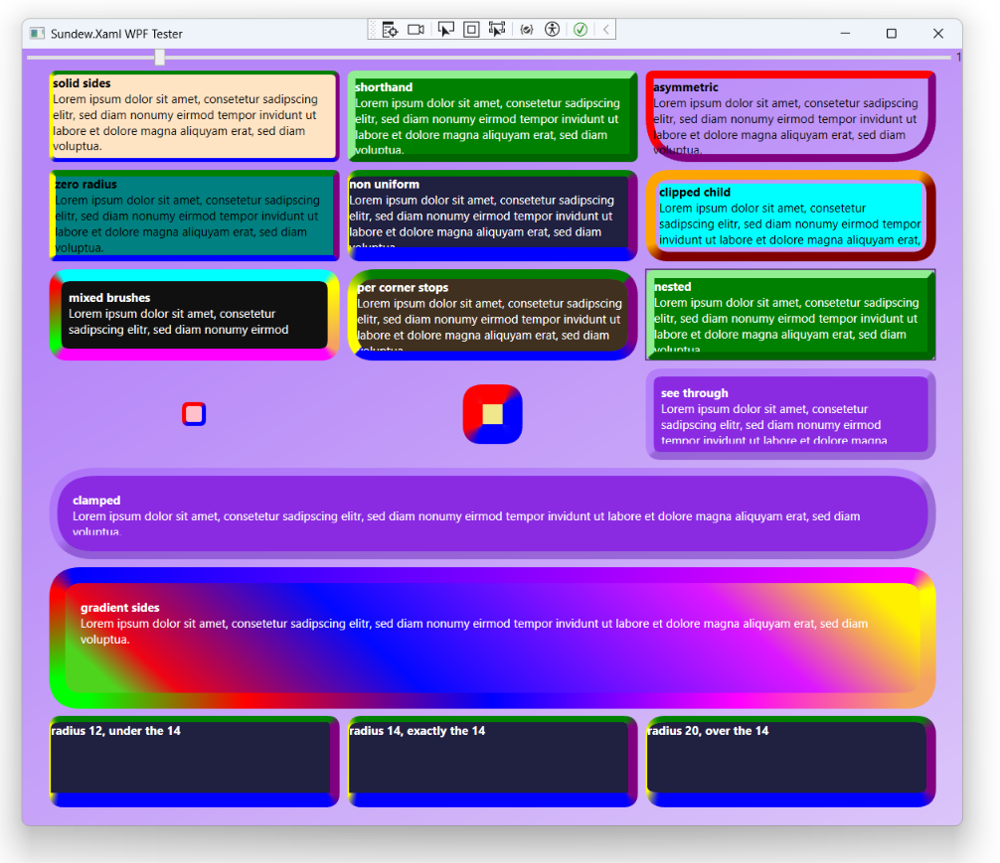

# Sundew.Xaml

## Controls:
* Border - A custom four-sided border, allowing more control over corner transitions. (WPF, Avalonia, WinUI, Uno)

### Examples:

### Known issues/Todo:
* CornerRadius 0 is not properly supported: a corner is never drawn tighter than the thicker of the two sides meeting
  it, so the corners of a square border are rounded by that thickness rather than left square.
* Performance optimizations

### WinUI and Uno notes:
* One package, `Sundew.Xaml.Controls.WinUI`, serves both WinUI 3 and every Uno target, because Uno implements the
  same `Microsoft.UI.Xaml` API. It cross targets `net9.0-windows10.0.19041.0`, which is WinUI 3 proper and also the
  Windows head of an Uno app, and `net9.0`, which is every other Uno target.
* Neither WinUI nor Uno lets a control paint itself the way WPF and Avalonia do, so the border is a `Panel` holding a
  drawing surface behind a plain `Border` that carries the content. The surface is the only part that differs:
  Win2D on Windows, Skia (`SKCanvasElement`) everywhere else. Both run the same `Border` over `IBorderDrawingSession`,
  and `BorderRenderer` holds the whole of how a border is painted, free of XAML and of any one graphics library.
  A further backend is a matter of implementing `IBorderDrawingSession` and nothing else.
* WinUI only lets `Clip` be a rectangle, so the rounded part of `ClipContentToCornerRadius` is left to the corner
  radius of the plain border holding the content, which both WinUI and Uno clip to natively.
* Neither WinUI nor Uno honours a `TypeConverter`, on the type or on the property, so `Stops`, `CornerStops` and
  `SideBrushes` carry `CreateFromString` as well, which both do honour. The attribute only exists where WinUI or Uno
  is referenced, so `Stops` and `CornerStops` live in `Source/Shared` and each platform library compiles its own
  copy. Sharing them as an assembly instead would put the same type name in two assemblies of one reference graph,
  which neither XAML compiler can resolve.
* `Background` deliberately hides `Panel.Background`, which a panel would otherwise paint as a plain rectangle with
  square corners behind the rounded border.
* WinUI has no `LayoutTransform` and its brushes have no `RelativeTransform`, so the tester sheet zooms with a render
  transform and its one rotated background gradient runs straight across instead.

### Development testers:
* `Sundew.Xaml.Wpf.Development.Tester`, `Sundew.Xaml.Avalonia.Development.Tester`,
  `Sundew.Xaml.WinUI.Development.Tester` and `Sundew.Xaml.Uno.Development.Tester` are all in the solution. WinUI has
  no AnyCPU platform, so the solution maps its own Any CPU onto that project's x64.
* The Uno tester is one Uno single project with four heads: `net10.0-desktop`, `net10.0-android`, `net10.0-ios` and
  `net10.0-browserwasm`. The last three need the android, ios and wasm-tools workloads, which a plain build agent
  does not have, so CI passes `-p:SundewUnoAllHeads=false` and builds the desktop head alone. Build one head with
  `dotnet build Source/Sundew.Xaml.Uno.Development.Tester -f net10.0-android`.
* Running the Android head needs one Android SDK that has both the platform the build compiles against and a system
  image for the emulator to boot. Where Visual Studio and Android Studio have each installed their own, neither has
  both, and the AVD only resolves its image under the SDK it was created in. Point `ANDROID_HOME` and
  `ANDROID_SDK_ROOT` at that one and add the missing platform to it:
  `sdkmanager --sdk_root=<that sdk> "platforms;android-36" "build-tools;36.0.0"`.
* The Avalonia tester has a desktop head (`net10.0`) and an Android head (`net10.0-android`) in one project. Android
  needs the android workload, so CI passes `-p:SundewAvaloniaAllHeads=false` there too. The control library itself
  needed no change for Android: it uses only core Avalonia drawing, so the Skia renderer Avalonia uses on Android
  draws it the same way it does on the desktop.
* Each tester shows the same sheet of examples. `ComparisonView` is that sheet with the content left out, which is
  what the platforms are compared on: text rasterises differently everywhere and would drown out the border.
* The WinUI and Uno testers take `--render <file>` and write that sheet to a PNG. They have to, because a border
  draws onto a canvas the compositor owns and neither a screen grab nor `RenderTargetBitmap` can read it back; the
  render mode asks each border to draw itself onto a surface of its own, through the very same code. It pins the
  device pixel scale rather than taking it from the display, so a captured sheet is the same wherever it was taken,
  and it records where each border was found, because two sheets are only comparable if the borders line up.

### How closely the platforms agree:
Rendering that sheet with geometry rounded at scale 1, out of 675,000 pixels:

| | differing at all | by more than 32 of 255 |
| --- | --- | --- |
| WPF against WinUI | 0.69% | **none at all** |
| WinUI against Uno | 1.61% | 0.38% |

The WinUI and Uno residual is not rendering. Twelve of the seventeen borders land at identical positions on both,
and every one of those twelve agrees to within 0.007% of pixels above 32. The other five are placed a little under
half a pixel apart, because Uno rounds some layout to the pixel grid of the display even where
`UseLayoutRounding` is off, and every differing pixel is along the edges of those five.

### Avalonia notes:
* `Border` derives from `Decorator` rather than from Avalonia's own `Border`, because the latter seals its rendering.
  `Background`, `BorderThickness` and `CornerRadius` are registered with `AddOwner`, so they are the very same
  `AvaloniaProperty` instances and existing styles and theme resources still apply.
* Avalonia has no `GuidelineSet`, so the guidelines the calculator produces are only used by WPF. Avalonia gets the
  same crisp edges a different way: the border measures its own scale and position all the way to the `TopLevel`, so
  that it rounds against the scale it is actually drawn at rather than `RenderScaling` alone, and nudges itself by up
  to half a device pixel so that its edges land on pixel boundaries. This matters under anything that scales the
  border from above, a zoom through a `LayoutTransformControl` say, which is applied after the border has drawn
  itself and would otherwise leave every edge half covering a pixel. A rotated or skewed border has no pixel grid to
  line up with and is left alone.
* A see through corner is drawn under an opacity mask rather than `PushOpacity`, because that one multiplies each
  slice of the swept blend on its own instead of compositing the corner as a whole, which shows the slices.
* WPF clips a child to the space it was arranged into whenever the child wanted more, so content that does not fit is
  cut off at the border. Avalonia has no such layout clip, so the border applies the same thing itself and content
  that overflows is cut off on both platforms rather than being drawn over the border and beyond it.
  `ClipContentToCornerRadius` then decides whether that clip follows the corners or is the plain content rectangle.

## Theming (WPF):
* ThemeManager - A theme manager with support for themes, theme modes and automatic synchronization with system theme.
* ThemeResourceDictionary - A caching resource dictionary for managing themes.
* ThemeModeResourceDictionary - A caching resource dictionary for managing theme modes.

## Controls.Overlays (WPF):
* OverlayWindow - A Window for overlays.
* SubtitleOverlay - A Window for displaying subtitles.
